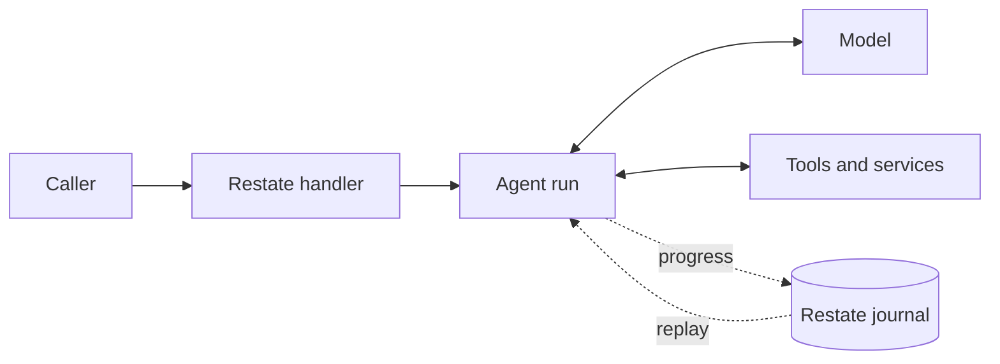

# Restate Agents

**TypeScript agents built for durable execution on [Restate](https://restate.dev).**
Run an agent inside a service handler, alongside ordinary application code.
Restate records its progress, so a crash, deploy, or long wait does not mean
starting the work over.

- **Survive the real world.** Model calls, tool results, and approvals are
  journaled; completed work is reused when an invocation resumes.
- **Stay in control while it runs.** Steer or interrupt an agent, check tool
  calls with guardrails, and pause for human approval.
- **Compose agents like services.** Call other handlers through durable RPC,
  delegate to sub-agents, or hand a conversation to a specialist.
- **Bring the tools you need.** Use async functions, Restate services, MCP,
  tool search, background work, and programmatic tool calling.

[Run it locally](#run-it-locally) · [Run it on Modal](#run-it-on-modal) ·
[Explore the capabilities](#capabilities) ·
[Follow the tutorial](https://github.com/restatedev/agentlib/tree/main/packages/examples)

## The shape of an agent

An agent runs inside your Restate service. Your handler decides when to run it
and what happens before and after. The agent can call a model, use tools, wait
for a person, and continue from the journal when the invocation resumes.



[src/app.ts](src/app.ts) is one agent and one handler:

```ts
import * as restate from "@restatedev/restate-sdk-gen";
import {agent} from "@restatedev/agentlib";
import {openAIModel} from "@restatedev/agentlib/openai";

const assistant = agent({model: openAIModel({model: "gpt-5.6-luna"})});

export const hello = restate.service({
  name: "Hello",
  handlers: {
    *ask(question: string) {
      const result = yield* assistant.run(question);
      // A stopped or interrupted run may still carry a summary in output.
      return result.status === "completed" ? result.output : (result.output ?? result.reason);
    },
  },
});
```

Each request starts with no conversation history. Add a
[conversation](https://github.com/restatedev/agentlib/blob/main/packages/examples/src/lessons/03_conversation.ts)
when the agent needs to remember earlier requests, or add
[tools](https://github.com/restatedev/agentlib/blob/main/packages/examples/src/lessons/02_tools.ts) when it needs to act.

## Before you start

- `RESTATE_CONNECT_KEY`: The connect key of your Restate Cloud environment, from
  [**Configure SDK -> Create connect key**](https://cloud.restate.dev/to/developers/integration#configure-sdk).
- `OPENAI_API_KEY`: An OpenAI API key. Other providers and models are listed
  under [capabilities](#capabilities).

## Run it locally

With Node 24 or later and pnpm:

```sh
pnpm install
node src/app.ts
```

Then, once, [register `connect://agentlib-template-v1`](https://cloud.restate.dev/to/overview?register-deployment=connect://agentlib-template-v1)
in the Cloud UI (the application prints this link too), or with the CLI:

```sh
npx @restatedev/restate@next deployments register connect://agentlib-template-v1
```

Ask a question from the [playground](https://cloud.restate.dev/to/overview?servicePlayground=Hello).

## Run it on Modal

[`modal/on_modal.py`](modal/on_modal.py) builds the image on Modal and runs the
app in one container, with your keys from a Modal secret:

```sh
pip install modal && modal setup
modal secret create agentlib-template RESTATE_CONNECT_KEY=${RESTATE_CONNECT_KEY} OPENAI_API_KEY=${OPENAI_API_KEY}
modal deploy modal/on_modal.py
```

Register `connect://agentlib-template-v1` as above, and send requests the same
way. `modal app logs agentlib-template` follows it.

## What you can build

- **Support that remembers and adapts.** Keep conversation history in a keyed
  object, and steer or interrupt an active run.
  [See the support session](https://github.com/restatedev/agentlib/blob/main/packages/examples/src/lessons/09_support_session.ts).
- **Actions with a human in the loop.** Pause a tool for approval or check a
  budget before it runs.
  [See human approval](https://github.com/restatedev/agentlib/blob/main/packages/examples/src/lessons/06_human_approval.ts) and
  [a tool guardrail](https://github.com/restatedev/agentlib/blob/main/packages/examples/src/lessons/13_tool_guardrail.ts).
- **Agents working together over RPC.** Fan out typed Restate RPCs and
  synthesize the results, or have agents review each other's drafts.
  [See the research report](https://github.com/restatedev/agentlib/blob/main/packages/examples/src/lessons/08_research_report.ts)
  and [the peer review](https://github.com/restatedev/agentlib/blob/main/packages/examples/src/lessons/15_peer_review_rpc.ts).
- **Coding in a Modal sandbox.** Give an agent file and shell tools backed by a
  [Modal](https://modal.com) sandbox (needs Modal credentials).
  [See the coding agent](https://github.com/restatedev/agentlib/blob/main/packages/examples/src/lessons/11_coding_agent.ts).

## Why it keeps working

Restate journals model responses, tool results, and workflow decisions. After a
crash or redeploy, an invocation replays completed steps and continues from the
next one. Your agent does not have to reconstruct its place in a workflow or
repeat a completed model call.

- **Retries are explicit.** Set retry policies on model calls and tools; a terminal
  tool failure becomes a result the agent can handle.
- **Cancellation propagates.** An interrupted run cancels unfinished tools and
  child invocations.
- **Waiting does not occupy a process.** Approvals, sleeps, and slow work
  suspend durably.
- **Composition stays in application code.** Race agents, fan out workers, or
  add an agent to a larger Restate workflow.

## Capabilities

| Capability                   | API                                                                        | Lesson                                                                                                       |
|------------------------------|----------------------------------------------------------------------------|--------------------------------------------------------------------------------------------------------------|
| Tools with journaled results | `asyncTool`, `tool`                                                        | [02](https://github.com/restatedev/agentlib/blob/main/packages/examples/src/lessons/02_tools.ts)             |
| Conversation history         | `run(input, {messages})`, `run(input, {conversation})`                     | [03](https://github.com/restatedev/agentlib/blob/main/packages/examples/src/lessons/03_conversation.ts), 09  |
| Typed output                 | `agent({output})`                                                          | [04](https://github.com/restatedev/agentlib/blob/main/packages/examples/src/lessons/04_structured_output.ts) |
| Human approval               | `needsApproval`, `onApproval`, `humanApprovalTool`                         | [06](https://github.com/restatedev/agentlib/blob/main/packages/examples/src/lessons/06_human_approval.ts)    |
| Steering and interruption    | `run(input, {steeringSignal, interruptSignal})` or `{controls}`            | [09](https://github.com/restatedev/agentlib/blob/main/packages/examples/src/lessons/09_support_session.ts)   |
| Progress events              | `run(input, {onProgress})`, `context.progress`                             | [16](https://github.com/restatedev/agentlib/blob/main/packages/examples/src/lessons/16_progress_feed.ts)     |
| Handoffs                     | `handoff`                                                                  | —                                                                                                            |
| Sub-agents as tools          | `agentTool`                                                                | —                                                                                                            |
| Restate services as tools    | `serviceTool`, `handlerTool`, `restateTools` (`/discovery`)                | [10](https://github.com/restatedev/agentlib/blob/main/packages/examples/src/lessons/10_service_tool.ts)      |
| Background tools             | `background: true`, `sleepTool`, `cancelOperationTool`                     | —                                                                                                            |
| Tool search                  | `searchToolsTool`, `deferred: true`                                        | —                                                                                                            |
| Programmatic tool calling    | `programTool` (`/program`), run in a QuickJS sandbox                       | —                                                                                                            |
| MCP                          | `mcpTools` (`/mcp`), passed as `run(input, {tools})`                       | [17](https://github.com/restatedev/agentlib/blob/main/packages/examples/src/lessons/17_mcp_tools.ts)         |
| AG-UI clients                | `onProgress`, `onApproval` and client-run tools as AG-UI events            | [18](https://github.com/restatedev/agentlib/blob/main/packages/examples/src/lessons/18_ag_ui.ts)             |
| Guardrails                   | `beforeRun`, `beforeStep`, `beforeTool`, `afterTool`, `afterRun`, `before` | [13](https://github.com/restatedev/agentlib/blob/main/packages/examples/src/lessons/13_tool_guardrail.ts)    |
| Web search                   | `webSearch` (`/web-search`)                                                | [14](https://github.com/restatedev/agentlib/blob/main/packages/examples/src/lessons/14_web_search.ts)        |
| Skills                       | `agent({skills})` with any `SkillSource`, `skills([...])`                  | [19](https://github.com/restatedev/agentlib/blob/main/packages/examples/src/lessons/19_skills.ts)            |
| Large tool results           | `agent({toolResults})`: previews, read on with `read_tool_result`          | —                                                                                                            |
| Long runs                    | `agent({compaction, contextWindow})`, `ContextOverflowError`               | —                                                                                                            |
| Limits                       | `maxSteps`, `maxToolCalls`, `maxToolDepth`, `maxOutputChars`, `finalize`   | —                                                                                                            |
| Custom model adapters        | `journaledModel`                                                           | —                                                                                                            |
| Models                       | `openAIModel` (`/openai`), `aiModel`, `modelGateway` (`/provider`)         | [shared.ts](https://github.com/restatedev/agentlib/blob/main/packages/examples/src/shared.ts)                |

Subpaths are imports from `@restatedev/agentlib`, such as
`@restatedev/agentlib/mcp`. `aiModel` accepts an OpenTelemetry `tracer`, and
marks prompt-cache points for Anthropic and Bedrock unless `caching: false`.

Agents run inside Restate's generator SDK.

## Using AI coding tools

If you use Claude Code or Codex, the `restate-agents` plugin is installed
automatically when you open this project: two skills, for the agent SDK and
for Restate's generator SDK, plus the Restate docs MCP server. For Cursor and
other tools, see the [agentlib README](https://github.com/restatedev/agentlib#skills-for-coding-agents).

## Using client to send requests

Get the ingress key of your Restate Cloud environment from
[**Configure SDK -> Create ingress key**](https://cloud.restate.dev/to/developers/integration#configure-sdk).

Then send requests using `@restatedev/restate-sdk-clients`:

```ts
import * as clients from "@restatedev/restate-sdk-clients";

const rs = clients.connect();
const hello = rs.serviceClient({name: "Hello"});
console.log(await hello.ask("What can you do?"));
```

## What's next

This is the first lesson of the [agent tutorial](https://github.com/restatedev/agentlib/tree/main/packages/examples).
Continue there for tools, conversations, human approval, guardrails, and
multi-agent workflows, each in a numbered file you can bring into this project.
